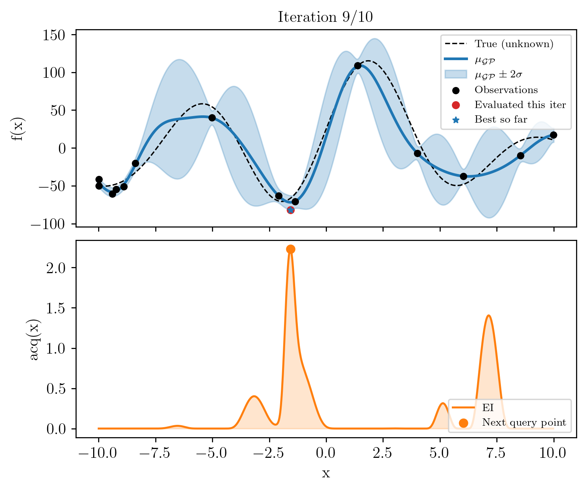

# pyRAMBO

**Bayesian optimization for expensive black-box functions, in plain NumPy and SciPy.**


pyRAMBO is a lightweight Bayesian optimization (BO) library built on
Gaussian-process surrogates. It handles single-objective, multi-fidelity and
multi-objective problems, and is aimed at objectives that are costly to
evaluate, such as numerical simulations or experiments.

It is developed within the
[Machine Learning for Fluid Systems group (ML4F)](https://www.mendezma.com/).

<p align="center">
  
</p>
<p align="center"><em>
  Top: GP posterior after 10 iterations on a noisy 1D objective.
  Bottom: the acquisition function that selects the next evaluation.
</em></p>

## Why "RAMBO"?

The name spells out what the library does:

| Letters | Stands for | In the library |
| --- | --- | --- |
| **py** | Python | Pure Python; depends only on NumPy, SciPy and Matplotlib |
| **R**, **A** | **R**ank-one **A**ccelerated | When a point is added, the Cholesky factor of the GP covariance is extended by one row instead of being recomputed: O(n²) instead of O(n³) per iteration |
| **M** | **M**ulti-objective, multi-fidelity, multi-output | Beyond the standard single-objective loop: several objectives (Pareto front), several fidelity levels, and a multi-output GP that models objectives jointly |
| **BO** | **B**ayesian **O**ptimization | The underlying method: fit a GP to the evaluations so far, then choose the next point by maximizing an acquisition function |

## Features

- **Gaussian-process surrogate** with an RBF kernel, input and output
  normalization, and hyperparameters fitted by bounded maximization of the
  marginal likelihood.
- **Acquisition functions:** Expected Improvement, Probability of Improvement
  and Upper Confidence Bound, maximized by random search, grid search, or
  multi-start L-BFGS-B.
- **Rank-one Cholesky updates** for large data sets (`GPConfig.rank_one`).
- **Batch acquisition:** several diverse candidates per iteration, for
  parallel evaluation budgets (`OptimConfig.n_candidates`).
- **Gradient-based refinement:** if the gradient of the objective is
  available (adjoint solver, automatic differentiation), each proposal is
  refined locally by projected ADAM before being added to the data set.
- **Multi-fidelity BO** with the autoregressive model of Kennedy and O'Hagan
  and a cost-aware acquisition that picks both the next point and its
  fidelity level.
- **Multi-objective BO** with a multi-output GP (intrinsic coregionalization
  model) and Monte-Carlo Expected Hypervolume Improvement, for two objectives.
- **Run persistence** in NumPy and JSON files: a per-iteration trace, plus
  optional snapshots from which the GP of any iteration can be rebuilt
  exactly.
- **Built-in plots:** GP posterior and acquisition at each iteration,
  convergence and sampling history, and an animated GIF of the run.

## Installation

pyRAMBO requires Python 3.9 or later.

Install it directly from GitHub:

```bash
pip install git+https://github.com/mendezVKI/BayesianOptimization_ML4F.git
```

Or clone the repository and install it in editable mode, which also gives you
the tutorials and the tests:

```bash
git clone https://github.com/mendezVKI/BayesianOptimization_ML4F.git
cd BayesianOptimization_ML4F
pip install -e ".[test]"
```

## Quick start

Minimize a function of one variable with 5 initial points and 15 BO
iterations:

```python
import numpy as np
from pyRAMBO import sbo


def f(x):
    """Objective to minimize. x is a NumPy array of shape (d,)."""
    return np.sin(3.0 * x[0]) + 0.5 * x[0] ** 2


res = sbo.bayesian_optimization(
    f=f,
    bounds=[(-2.0, 2.0)],          # one (low, high) pair per dimension
    bo_cfg=sbo.BOConfig(n_init=5, n_iter=15, random_state=0),
    gp_cfg=sbo.GPConfig(),         # GP surrogate and its hyperparameters
    acq_cfg=sbo.AcqConfig(kind="EI"),   # "EI", "PI" or "UCB"
    optim_cfg=sbo.OptimConfig(),   # how the acquisition is maximized
    save_cfg=sbo.SaveConfig(),     # nothing is written to disk by default
)

print(res.best_x, res.best_y)      # about [-0.49] -0.875  (true minimum: -0.877 at x = -0.47)
```

Every setting lives in one of five small configuration objects, each with
sensible defaults:

| Object | Controls |
| --- | --- |
| `BOConfig` | Budget (`n_init`, `n_iter`), initial sampling, random seed |
| `GPConfig` | Kernel hyperparameters, their optimization, normalization, rank-one update |
| `AcqConfig` | Acquisition function and its parameters; `maximize=True` to maximize instead |
| `OptimConfig` | Acquisition optimizer, batch size |
| `SaveConfig` | Output folder, logging, persistence, plots |

The returned `BOResult` holds all evaluations (`X`, `y`), the best point
(`best_x`, `best_y`), the final GP (`gp`), and the per-iteration record
(`trace`, `states`).

## The three subpackages

pyRAMBO is one package with three independent subpackages that share the
same structure and calling pattern:

| Subpackage | Problem | Entry point |
| --- | --- | --- |
| `pyRAMBO.sbo` | Single objective, single fidelity | `sbo.bayesian_optimization` |
| `pyRAMBO.mfbo` | Two fidelity levels of the same objective | `mfbo.multi_fidelity_bayesian_optimization` |
| `pyRAMBO.mobo` | Two objectives, Pareto front | `mobo.multi_objective_bayesian_optimization` |

Rank-one updates, batch acquisition and gradient refinement are available in
`sbo`. The rank-one update is used once the data set exceeds
`GPConfig.rank_one_threshold` points (1000 by default), on the iterations
where the hyperparameters are not re-optimized (see `GPConfig.hpo_every`).

### Batch proposals and gradient refinement

```python
def grad(x):
    """Gradient of f, same shape as x."""
    return np.array([3.0 * np.cos(3.0 * x[0]) + x[0]])


res = sbo.bayesian_optimization(
    f=f,
    bounds=[(-2.0, 2.0)],
    bo_cfg=sbo.BOConfig(n_init=5, n_iter=5, random_state=0),
    gp_cfg=sbo.GPConfig(),
    acq_cfg=sbo.AcqConfig(),
    optim_cfg=sbo.OptimConfig(n_candidates=3),   # 3 diverse proposals per iteration
    save_cfg=sbo.SaveConfig(),
    gradient=grad,
    refinement_cfg=sbo.GradientRefinementConfig(enabled=True),
)
```

### Multi-fidelity

A cheap, biased model `f_low` guides the search, so that fewer evaluations
of the expensive `f_high` are needed:

```python
from pyRAMBO import mfbo


def f_high(x):   # expensive and accurate
    return (6.0 * x[0] - 2.0) ** 2 * np.sin(12.0 * x[0] - 4.0)


def f_low(x):    # cheap and biased
    return 0.5 * f_high(x) + 10.0 * (x[0] - 0.5) - 5.0


res = mfbo.multi_fidelity_bayesian_optimization(
    f_low=f_low,
    f_high=f_high,
    bounds=[(0.0, 1.0)],
    mfbo_cfg=mfbo.MFBOConfig(n_init_L=8, n_init_H=3, n_iter=20, random_state=0),
    gp_cfg=mfbo.GPConfig(l_lf=0.2, sigma_lf=5.0, l_delta=0.2, sigma_delta=3.0,
                         rho=1.0, sigma_L=0.05, sigma_H=0.02),
    acq_cfg=mfbo.AcqConfig(),
    optim_cfg=mfbo.OptimConfig(method="refined"),
    fidelity_cfg=mfbo.FidelityConfig(cost_low=1.0, cost_high=10.0),
    save_cfg=mfbo.SaveConfig(),
)

print(res.best_x, res.best_y)          # about [0.757] -6.02  (true minimum: -6.02 at x = 0.757)
print(len(res.y_L), len(res.y_H))      # number of low- and high-fidelity evaluations
```

### Multi-objective

The objective returns one value per objective, and the result is a Pareto
front instead of a single best point:

```python
from pyRAMBO import mobo


def f(x):        # two objectives, both minimized
    return np.array([x[0] ** 2, (x[0] - 2.0) ** 2])


res = mobo.multi_objective_bayesian_optimization(
    f=f,
    bounds=[(-4.0, 4.0)],
    mobo_cfg=mobo.MOBOConfig(n_init=6, n_iter=15, random_state=0),
    gp_cfg=mobo.GPConfig(),
    acq_cfg=mobo.AcqConfig(),
    optim_cfg=mobo.OptimConfig(),
    save_cfg=mobo.SaveConfig(),
)

print(res.pareto_X, res.pareto_Y)      # non-dominated points and their objective values
print(res.hypervolume)                 # dominated hypervolume w.r.t. res.ref_point
```

## Saving and reloading a run

Set `SaveConfig.out_path` to write a run to disk. Each run gets its own
subfolder:

```
<out_path>/<run name>/
    log.log        start and end of the run
    plots/         figures, if plotting is enabled
    res/
        meta.json  full configuration of the run
        trace.npz  per-iteration record (also written as trace.csv)
        snapshots/ one file per iteration, if snapshots are enabled
```

Persistence has two tiers, both stored as NumPy and JSON files:

- **Trace (always on):** proposed point, observed value, best value so far,
  wall-clock time and hyperparameters at every iteration.
- **Snapshots (opt-in):** what is needed to rebuild the GP of a given
  iteration exactly (data, hyperparameters, normalization), never the dense
  covariance matrices.

```python
res = sbo.bayesian_optimization(
    f=f,
    bounds=[(-2.0, 2.0)],
    bo_cfg=sbo.BOConfig(n_init=5, n_iter=15, random_state=0),
    gp_cfg=sbo.GPConfig(),
    acq_cfg=sbo.AcqConfig(),
    optim_cfg=sbo.OptimConfig(),
    save_cfg=sbo.SaveConfig(out_path="my_runs", snapshot_enabled=True),
)

# Later, without re-running the objective:
run = sbo.load_run(res.out_path)
mu, var = run.posterior(10).predict(np.linspace(-2, 2, 200).reshape(-1, 1))
```

To produce figures, set `plt_all=True` in `SaveConfig`, or enable individual
plots (`plt_state_enabled`, `plt_conv_enabled`, `plt_hist_enabled`).
`sbo.make_gif(res.out_path)` then assembles the per-iteration figures into an
animation.

> **Note:** the figures drawn by the library use LaTeX for text rendering, so
> plotting requires a LaTeX installation (TeX Live or MiKTeX, with `dvipng`).
> Runs without plots do not need it.

## Tutorials

The repository contains runnable scripts, split into `#%%` cells so that they
can be stepped through in Spyder or VS Code.

| Script | Shows |
| --- | --- |
| [`simple_cases/sbo/main_1D_sin.py`](simple_cases/sbo/main_1D_sin.py) | The basic loop on a noisy 1D objective |
| [`simple_cases/sbo/main_1D_sin_large_scale.py`](simple_cases/sbo/main_1D_sin_large_scale.py) | Input and output normalization on an objective with large scales |
| [`simple_cases/sbo/main_2D_branin.py`](simple_cases/sbo/main_2D_branin.py) | A 2D problem, with posterior and acquisition maps |
| [`simple_cases/sbo/main_2D_rosenbrock.py`](simple_cases/sbo/main_2D_rosenbrock.py) | A 2D problem with a narrow curved valley |
| [`simple_cases/sbo/main_persistence_demo.py`](simple_cases/sbo/main_persistence_demo.py) | Saving a run, reloading it from disk and re-plotting it |
| [`advanced_cases/burgers_control/`](advanced_cases/burgers_control/) | Feedback control of a Burgers wave (one PDE simulation per evaluation), compared with scikit-optimize |

Run a tutorial from the repository root:

```bash
python -m simple_cases.sbo.main_1D_sin_large_scale
```

Results are written to `simple_cases/_output/`. See
[`simple_cases/README.md`](simple_cases/README.md) for details. The Burgers
case needs a few extra packages, listed in its own
[README](advanced_cases/burgers_control/README.md).

## Running the tests

```bash
pytest
```

## Repository layout

```
src/pyRAMBO/
    sbo/            single-objective BO
    mfbo/           multi-fidelity BO
    mobo/           multi-objective BO
        core.py         configuration, GP model, acquisition, BO driver
        saving.py       run folders and logging
        persistence.py  trace and snapshots, reloading a run
        plotting.py     figures
simple_cases/       tutorials on analytical benchmark functions
advanced_cases/     application cases
tests/              test suite
paper/              JOSS paper (in preparation)
```

Each subpackage has the same four modules (`sbo` also has `refinement.py`
for the gradient-based refinement). The subpackages do not import from each
other.

## Citing

A paper describing pyRAMBO is in preparation for the Journal of Open Source
Software; the draft is in [`paper/`](paper/). Until it is published, please
cite this repository.

## License

pyRAMBO is released under the [MIT License](LICENSE).

## Authors

Yannick Lecomte and Miguel A. Mendez,
[Machine Learning for Fluid Systems group (ML4F)](https://www.mendezma.com/).
